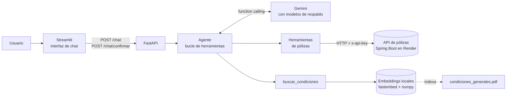
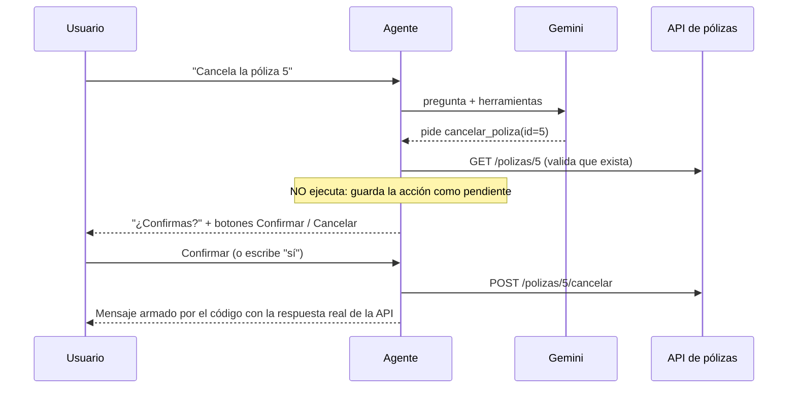

# Agente de IA para consultar pólizas de seguro

Agente en Python que responde preguntas en español sobre pólizas de seguro. Consulta datos reales de la [API de pólizas](../README.md) (Spring Boot, desplegada en Render) mediante *function calling* con Google Gemini, y responde dudas sobre las condiciones generales del seguro leyendo un PDF con RAG. Antes de renovar o cancelar una póliza siempre pide confirmación, y cada respuesta muestra qué herramientas usó.

## El problema de negocio

En una aseguradora, el equipo comercial y el de servicio al cliente necesitan respuestas rápidas: "¿qué pólizas colectivas siguen activas?", "¿cuántos riesgos tiene la póliza 2?", "¿el seguro cubre terremotos?". Hoy eso exige abrir Swagger, conocer los endpoints o buscar en un PDF de condiciones.

El agente permite preguntarlo en lenguaje natural:

- **Consulta datos reales** de la API, sin que la persona sepa qué endpoint llamar.
- **Responde sobre el contrato** citando cláusula y página del documento.
- **Ejecuta acciones** (renovar, cancelar) solo con confirmación explícita del usuario.
- **Es trazable**: cada respuesta dice qué herramientas usó y con qué argumentos, para poder auditarla.

## Qué puede hacer

| Herramienta | Qué hace | Fuente |
|---|---|---|
| `listar_polizas` | Lista pólizas, con filtros opcionales por tipo y estado | `GET /polizas` |
| `consultar_poliza` | Detalle de una póliza | `GET /polizas/{id}` |
| `ver_riesgos` | Riesgos (inmuebles asegurados) de una póliza | `GET /polizas/{id}/riesgos` |
| `renovar_poliza` | Renueva un año y aplica el IPC. **Pide confirmación** | `POST /polizas/{id}/renovar` |
| `cancelar_poliza` | Cancela la póliza y sus riesgos. **Pide confirmación** | `POST /polizas/{id}/cancelar` |
| `buscar_condiciones` | Busca en las condiciones generales del seguro (RAG) | [PDF de ejemplo](data/condiciones_generales.pdf) |

### Ejemplos de preguntas

- ¿Qué pólizas colectivas están activas?
- ¿Qué riesgos tiene la póliza 2?
- De esas, ¿cuál vence primero? *(recuerda la conversación)*
- Si renuevo la póliza 5, ¿en cuánto quedaría el canon? *(combina la API con el IPC; no renueva nada)*
- ¿Qué no cubre el seguro? / Si hay un terremoto, ¿me pagan? *(responde desde el PDF, citando la cláusula)*
- ¿Cuánto tiempo tengo para avisar si el inquilino no me paga?
- Renueva la póliza 4 *(queda pendiente hasta que confirmes)*

## Arquitectura



### El bucle del agente

1. Se le envía al LLM la conversación y la lista de herramientas (nombre, descripción y parámetros).
2. Si el LLM responde con texto, termina.
3. Si pide una herramienta, **el código** la ejecuta (el LLM nunca ejecuta nada), le devuelve el resultado y vuelve al paso 1.
4. Cada herramienta usada queda registrada para mostrarla en la respuesta.
5. Un tope de 6 vueltas evita ciclos infinitos.

El bucle está escrito a mano con el SDK oficial `google-genai`, sin LangChain, en [`app/agent/agente.py`](app/agent/agente.py). El agente no depende de Gemini: habla con una interfaz propia ([`app/agent/llm.py`](app/agent/llm.py)), y cada proveedor tiene un adaptador. Cambiar de proveedor es escribir un adaptador nuevo y cambiar `LLM_PROVIDER` en el `.env`.

### Confirmación antes de cambiar datos



La regla vive en el código, no en el prompt: aunque el modelo se equivoque, ninguna renovación ni cancelación ocurre sin la confirmación del usuario. La confirmación sirve una sola vez, y cualquier otro mensaje la descarta.

### RAG sobre el PDF

1. El PDF se parte por cláusulas (títulos numerados), y las cláusulas largas en fragmentos de unos 250 caracteres.
2. Cada fragmento se convierte en un *embedding* (384 números) con `paraphrase-multilingual-MiniLM-L12-v2`, que corre en local con `fastembed` (ONNX, sin PyTorch).
3. Con cada pregunta se calcula la **similitud coseno** contra todos los fragmentos (`numpy`, una multiplicación de matrices) y se entregan al LLM las cláusulas **completas** de los fragmentos más parecidos, con su página.

El tamaño de los fragmentos se eligió midiendo con 6 preguntas de evaluación ([`tests/test_rag.py`](tests/test_rag.py)): con 700 caracteres, "¿cubre terremotos?" no encontraba la cláusula de exclusiones; con 250 aciertan las 6.

### Manejo de errores

| Situación | Qué hace |
|---|---|
| API dormida en Render (medido: hasta 145 s) | Reintenta hasta 5 veces con espera creciente (2, 4, 8, 16 s) |
| `401` de la API | Mensaje claro sobre `POLIZAS_API_KEY`. No reintenta |
| `404` / `422` de la API | El LLM explica el mensaje de la API (ej. "No se puede renovar una póliza cancelada") |
| Timeout en un POST | **No reintenta**: podría renovar dos veces. Antes despierta la API con una lectura segura |
| Gemini saturado (`5xx`) o cuota agotada (`429`) | Pasa al siguiente modelo de respaldo; si todos fallan, mensaje claro |

## Tecnologías

- Python 3.11+ (desarrollado con 3.14)
- FastAPI + Uvicorn (API del agente)
- Google Gemini con `google-genai` (function calling)
- fastembed + numpy + pypdf (RAG local)
- Streamlit (interfaz)
- httpx (cliente HTTP)
- pydantic-settings (configuración)
- pytest + respx (pruebas)
- Docker y Docker Compose

## Cómo correrlo

Necesitas una clave gratuita de Gemini: https://aistudio.google.com/apikey

Todos los comandos se ejecutan dentro de la carpeta `agente/`.

### Opción 1: Docker (lo más simple)

```bash
cp .env.example .env
```

Edita `.env` y llena `POLIZAS_API_KEY` y `GEMINI_API_KEY`. Después:

```bash
docker compose up --build
```

- Interfaz de chat: http://localhost:8501
- API del agente (Swagger): http://localhost:8000/docs

Si esos puertos están ocupados: `PUERTO_AGENTE=8010 PUERTO_INTERFAZ=8502 docker compose up --build`. La imagen ya trae el modelo de embeddings, así que el RAG funciona sin descargar nada al arrancar.

### Opción 2: en local

```bash
python -m venv .venv
```

```bash
source .venv/Scripts/activate
```

(En Linux o macOS: `source .venv/bin/activate`.)

```bash
pip install -r requirements-dev.txt
```

```bash
cp .env.example .env
```

Edita `.env` con tus claves y arranca el agente:

```bash
uvicorn app.main:app --reload --reload-dir app
```

En otra terminal, con el entorno activado, la interfaz:

```bash
streamlit run ui/app.py
```

La primera pregunta sobre el PDF descarga el modelo de embeddings (~220 MB, una sola vez).

### Variables de entorno

| Variable | Por defecto | Uso |
|---|---|---|
| `POLIZAS_API_URL` | URL de Render | Base de la API de pólizas |
| `POLIZAS_API_KEY` | (obligatoria) | Header `x-api-key` |
| `POLIZAS_API_TIMEOUT` / `POLIZAS_API_INTENTOS` | `30` / `5` | Segundos por intento e intentos totales |
| `LLM_PROVIDER` | `gemini` | Proveedor del LLM |
| `LLM_MODEL` | `gemini-3.5-flash` | Modelo principal |
| `LLM_MODELOS_RESPALDO` | `gemini-3.5-flash-lite,gemini-3.1-flash-lite` | Modelos de respaldo, separados por coma |
| `GEMINI_API_KEY` | (obligatoria) | Clave de Gemini |
| `CONDICIONES_PDF` | `data/condiciones_generales.pdf` | Documento del RAG |
| `EMBEDDINGS_MODELO` / `EMBEDDINGS_CACHE` | MiniLM multilingüe / `.cache/fastembed` | Modelo de embeddings y dónde se guarda |

### API del agente

```bash
curl -X POST http://localhost:8000/chat -H "Content-Type: application/json" -d '{"mensaje": "¿Qué pólizas colectivas están activas?"}'
```

Respuesta (resumida):

```json
{
  "respuesta": "Actualmente hay 2 pólizas colectivas activas: ...",
  "sesion_id": "69fd934e-...",
  "herramientas_usadas": [
    {"nombre": "listar_polizas", "argumentos": {"tipo": "COLECTIVA", "estado": "ACTIVA"}, "estado": "ok", "detalle": "2 resultado(s)"}
  ],
  "accion_pendiente": null
}
```

Para seguir la conversación se envía el mismo `sesion_id`. Si la respuesta trae `accion_pendiente`, se confirma con `POST /chat/confirmar` (`sesion_id`, `accion_id`, `confirmar`) o escribiendo "sí" / "no".

## Pruebas

```bash
pytest
```

38 pruebas en unos 2 segundos. Simulan Gemini y la API de pólizas, así que no gastan cuota ni necesitan red:

- **Cliente HTTP**: reintentos con API dormida, 401 sin reintento, mensajes de error de la API y POST enviado una sola vez.
- **Agente**: uso de herramientas, trazabilidad, errores, tope de vueltas y, sobre todo, que renovar y cancelar **no se ejecutan** sin confirmación.
- **Endpoints**: confirmación con botón y con "sí"/"no", confirmación de un solo uso y error 503 cuando Gemini falla.
- **Gemini**: cambio al modelo de respaldo con 429 o 5xx.
- **RAG**: fragmentación del PDF y búsqueda con un modelo de embeddings falso.

Evaluación de la búsqueda con el modelo real (6 preguntas con su cláusula esperada):

```bash
pytest -m lento
```

## Limitaciones conocidas

- **Cuota gratuita de Gemini**: unas 20 consultas al día y 5 por minuto por modelo, y cada pregunta usa 2 o más. Los modelos de respaldo amplían el margen a unas 30 preguntas diarias.
- **Conversaciones en memoria**: se pierden al reiniciar el agente. En producción irían en Redis o en una base de datos.
- **API en el plan gratuito de Render**: la primera pregunta después de un rato sin uso puede tardar hasta 2,5 minutos.
- **El PDF es ficticio**, escrito para la demostración, con reglas que coinciden con las de la API.

## Estructura

```
agente/
├── app/
│   ├── main.py             FastAPI: /chat, /chat/confirmar y sesiones
│   ├── config.py           Configuración desde .env
│   ├── agent/
│   │   ├── agente.py       Bucle del agente y acciones pendientes
│   │   ├── llm.py          Interfaz común del LLM
│   │   └── gemini.py       Adaptador de Gemini con modelos de respaldo
│   ├── tools/
│   │   ├── cliente_api.py  Cliente HTTP con reintentos
│   │   └── herramientas.py Las 6 herramientas del agente
│   └── rag/buscador.py     Fragmentación, embeddings y búsqueda
├── ui/app.py               Interfaz de chat (Streamlit)
├── data/                   PDF de condiciones generales
├── scripts/generar_pdf.py  Genera el PDF de ejemplo
├── tests/                  Pruebas con pytest
├── docs/PLAN.md            Plan, decisiones de diseño y por qué
├── Dockerfile
└── docker-compose.yml
```

Las decisiones de diseño, con sus alternativas y el porqué, están en [docs/PLAN.md](docs/PLAN.md).

## Autor

**Leonardo Castro** — Ingeniero Mecatrónico y desarrollador Full Stack
[GitHub](https://github.com/hankcas)

Desarrollado con apoyo de Claude (Anthropic) como asistente de programación.
