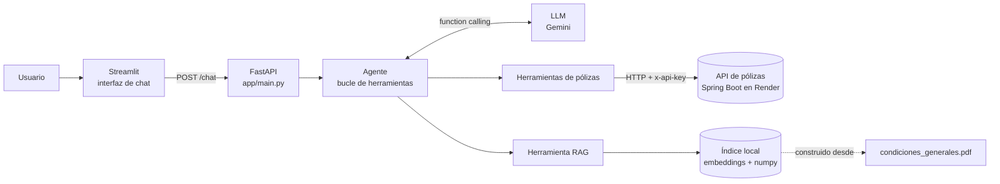
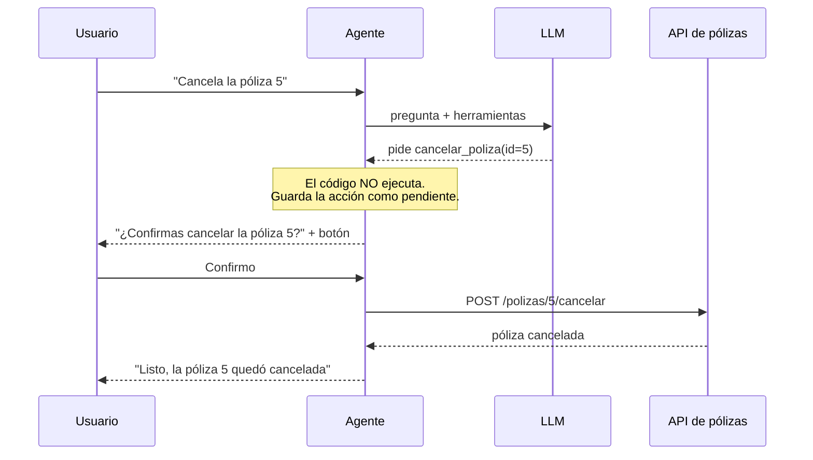

# Plan del proyecto agente-polizas

## El problema de negocio

En una aseguradora, el equipo comercial o de servicio al cliente necesita saber cosas como "¿qué pólizas colectivas siguen activas?" o "¿cuántos riesgos tiene la póliza 2?". Hoy eso exige abrir Swagger o pedírselo a alguien de sistemas. El agente permite preguntarlo en español normal: el modelo de lenguaje entiende la pregunta, decide qué endpoint de la API consultar y redacta la respuesta. También responde dudas sobre las condiciones generales del seguro, leyendo el documento.

## Arquitectura



### Cómo funciona el bucle del agente

1. Llega la pregunta del usuario.
2. Se la enviamos al LLM junto con la lista de herramientas disponibles (nombre, descripción y parámetros de cada una).
3. El LLM responde de una de dos formas:
   - **Texto**: ya tiene la respuesta. Terminamos.
   - **Llamada a herramienta** (function calling): por ejemplo `listar_polizas(tipo="COLECTIVA")`. El LLM **no ejecuta nada**, solo pide. Nuestro código ejecuta la función de Python, que llama a la API, y le devolvemos el resultado al LLM. Volvemos al paso 3.
4. Anotamos cada herramienta usada para mostrarla en la respuesta (trazabilidad).
5. Ponemos un límite de vueltas para que un error del modelo no lo deje en un ciclo infinito.

### Confirmación antes de cambiar datos (humano en el ciclo)



La regla vive en el código, no en el prompt: aunque el modelo se equivoque, ninguna renovación ni cancelación sucede sin el clic o el "sí" del usuario.

## Herramientas del agente

| Herramienta | Endpoint | ¿Cambia datos? |
|---|---|---|
| `listar_polizas(tipo?, estado?)` | `GET /polizas` | No |
| `consultar_poliza(id)` | `GET /polizas/{id}` | No |
| `ver_riesgos(poliza_id)` | `GET /polizas/{polizaId}/riesgos` | No |
| `renovar_poliza(id)` | `POST /polizas/{id}/renovar` | Sí, pide confirmación |
| `cancelar_poliza(id)` | `POST /polizas/{id}/cancelar` | Sí, pide confirmación |
| `buscar_condiciones(pregunta)` | Índice local del PDF (RAG) | No |

Valores válidos (del Swagger): `tipo` = `INDIVIDUAL` o `COLECTIVA`; `estado` = `ACTIVA`, `CANCELADA` o `RENOVADA`.

## Manejo de errores de la API

| Situación | Qué hace el agente |
|---|---|
| Render dormido (medido: hasta 145 s en despertar) | Hasta 5 intentos de 30 s con espera creciente (2, 4, 8, 16 s) y avisa "la API está despertando" |
| Gemini saturado (`5xx`) | El SDK reintenta una vez; si sigue saturado, pasa al siguiente modelo de `LLM_MODELOS_RESPALDO` |
| Cuota gratuita agotada (`429`: medido, 20 consultas al día y 5 por minuto **por modelo**) | No reintenta (esperar no sirve si se acabó la del día): pasa directo al siguiente modelo, que tiene su propia cuota. Si todos están agotados, mensaje claro al usuario |
| Timeout en un POST (renovar/cancelar) | **No reintenta**: el primer intento pudo haber llegado y se renovaría dos veces. Antes del POST despierta la API con `GET /actuator/health`, que sí se puede repetir sin riesgo |
| Timeout después de todos los intentos | Le explica al usuario que la API no respondió, sin inventar datos |
| `401` | Mensaje claro: la API key del `.env` es incorrecta. No reintenta |
| `404` / `422` | Le pasa el mensaje de la API al LLM para que lo explique (ej. "no se puede renovar una póliza cancelada") |

## Estructura final esperada

El agente vive en la carpeta `agente/` del mismo repositorio que la API, así el portafolio muestra las dos piezas juntas: la API en Java y el agente de IA en Python que la consume.

```
polizas_api/
├── polizasapi/             API Spring Boot (ya existente)
├── render.yaml             Despliegue de la API en Render
└── agente/                 Este proyecto
    ├── app/
    │   ├── config.py           Configuración desde .env
    │   ├── main.py             FastAPI: POST /chat
    │   ├── agent/              Bucle del agente y adaptador del LLM (Gemini)
    │   ├── tools/              Cliente HTTP de la API y herramientas
    │   └── rag/                Lectura del PDF, embeddings y búsqueda
    ├── ui/app.py               Interfaz de chat (Streamlit)
    ├── data/                   PDF de condiciones generales
    ├── tests/                  Pruebas con pytest (LLM y API simulados)
    ├── Dockerfile
    ├── docker-compose.yml      Agente + interfaz con un solo comando
    ├── .env.example
    └── README.md
```

Todos los comandos del agente (instalar, correr, probar) se ejecutan dentro de la carpeta `agente/`.

## Etapas

1. **Estructura y plan** (este documento, configuración, git).
2. **Agente con una herramienta**: `listar_polizas` de punta a punta, con `POST /chat` y trazabilidad.
3. **Resto de herramientas**: consultar, riesgos, y renovar/cancelar con confirmación forzada.
4. **RAG**: crear el PDF de ejemplo, partirlo en fragmentos, embeddings locales y búsqueda por similitud.
5. **Interfaz, pruebas, Docker y README**.

## Decisiones y por qué (para defender en la entrevista)

| Decisión | Alternativa descartada | Razón |
|---|---|---|
| Bucle del agente escrito a mano con el SDK `google-genai` | LangChain / LangGraph | Se entiende cada paso y se puede explicar. Un framework esconde justo lo que una entrevista pregunta |
| El LLM detrás de una interfaz propia (`LLM_PROVIDER` en `.env`) | Llamar a Gemini directo en todo el código | Cambiar de proveedor es escribir un adaptador, sin tocar el agente |
| Confirmación forzada en código | Pedírselo al LLM en el prompt | Un prompt es una sugerencia; el código es una garantía |
| `fastembed` + `numpy` para el RAG | `sentence-transformers` (PyTorch, ~2 GB) o embeddings de Gemini | Corre local y gratis, imagen Docker liviana, y la búsqueda (similitud coseno) cabe en pocas líneas |
| `httpx` para llamar a la API | `requests` | Tiene timeouts claros y se simula fácil en pruebas con `respx` |
| `pydantic-settings` para la configuración | Leer `os.environ` a mano | Valida tipos y avisa al arrancar si falta una variable obligatoria |
| RAG: fragmentos de 250 caracteres, pero se entrega la cláusula completa ("de pequeño a grande") | Fragmentos grandes (700) | Medido con 6 preguntas de prueba: con 700, "¿cubre terremotos?" no encontraba EXCLUSIONES; con 250 aciertan 6 de 6. Pero entregar solo el pedazo dejaba listas incompletas (3 de 9 exclusiones), por eso se entrega la cláusula entera |
| PDF partido por cláusulas (títulos numerados) | Cortes fijos cada N caracteres | Cada cláusula trata un solo tema y permite citar "cláusula 6, página 1" |
| Varios modelos de respaldo | Un solo modelo | El plan gratuito permite ~10 preguntas al día por modelo; con 3 modelos alcanza para una demo |
